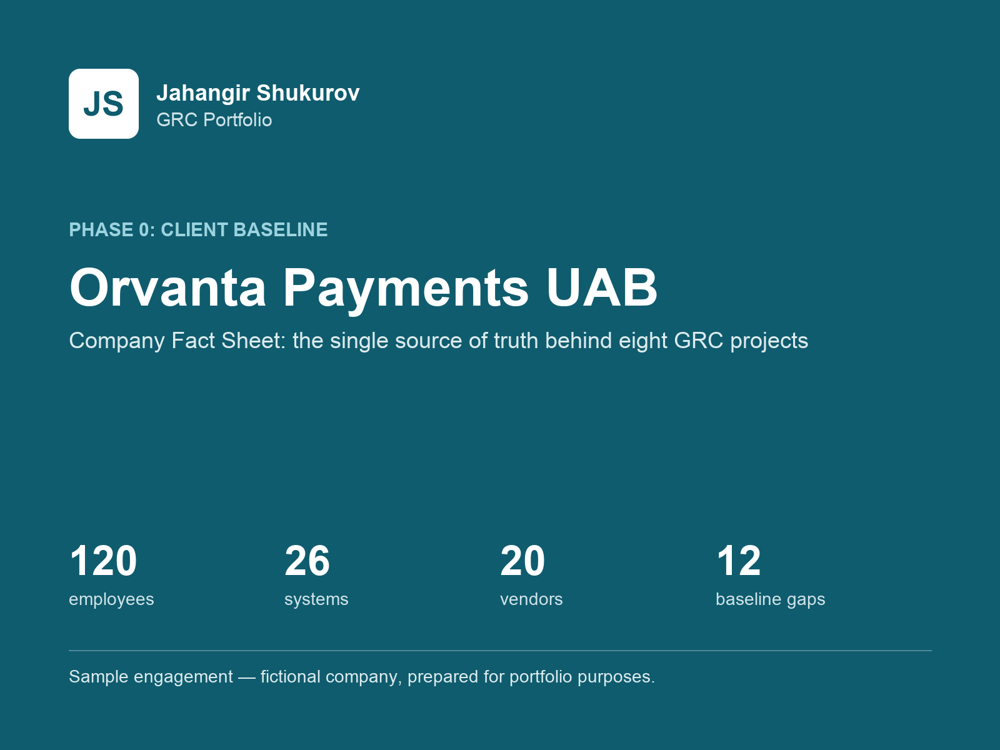
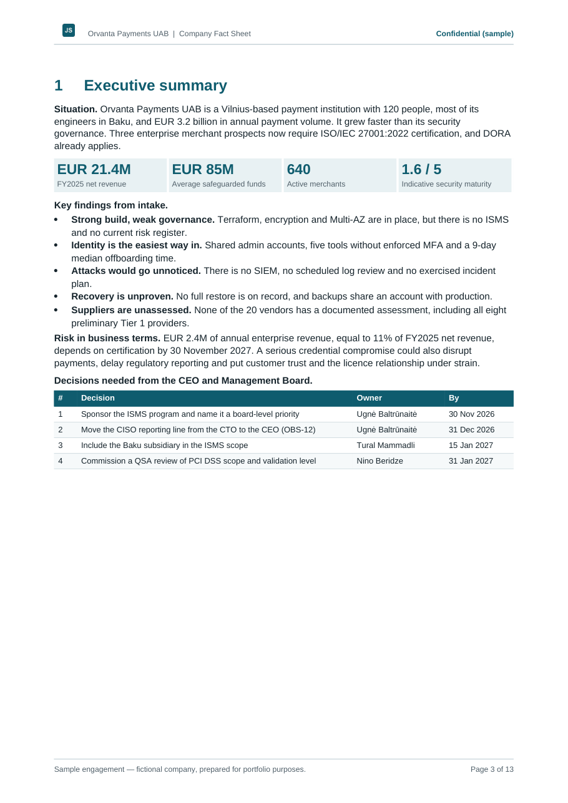
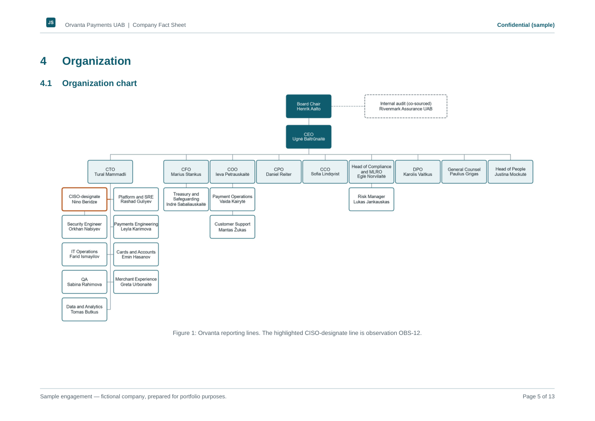
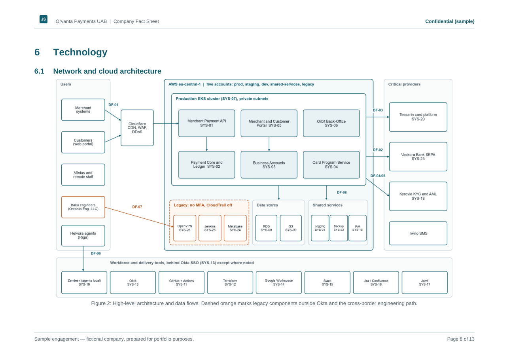

# Company Fact Sheet: Orvanta Payments UAB

> **Sample engagement — fictional company, prepared for portfolio purposes.**

## Client situation

Orvanta is a fictional Lithuanian payment institution with 120 people, EUR 3.2 billion in annual payment volume and most of its engineers in Baku. Three enterprise prospects worth EUR 2.4M a year made ISO/IEC 27001:2022 certification a contract condition, and DORA already applies. Its technology is modern, but its security governance has not kept pace.

## Objectives

Create one trusted baseline, so that every later project uses the same people, systems, vendors, numbers and IDs.

## Approach

- Expanded the seed brief into a realistic organization, technology estate and supplier base.
- Stored all facts in one [machine-readable master file](data/orvanta_master.json), with a [validation script](../tools/validate_master.py) that checks IDs, references and headcount.
- Paired each baseline weakness with how an attacker would use it.
- Checked regulatory facts against official sources where reachable, and flagged the rest for verification inside the document.

## Deliverables

- [Company Fact Sheet (PDF)](deliverables/Orvanta-Company-Fact-Sheet.pdf)
- [Company Fact Sheet (Word)](deliverables/Orvanta-Company-Fact-Sheet.docx)

## Key outcomes

- 24 named roles, 12 business processes, 26 systems, 8 data flows and 20 vendors.
- 7 regulatory and contractual drivers, each with a stated verification status.
- 12 baseline observations and an indicative maturity of 1.6 out of 5, to be replaced by the formal assessment in Project 1.

## Skills and frameworks

Business and technology scoping, cloud architecture mapping, data classification, regulatory scoping (DORA, GDPR, PCI DSS v4.0.1, NIS2, ISO/IEC 27001:2022), threat-informed analysis, data validation with Python.

## Preview

