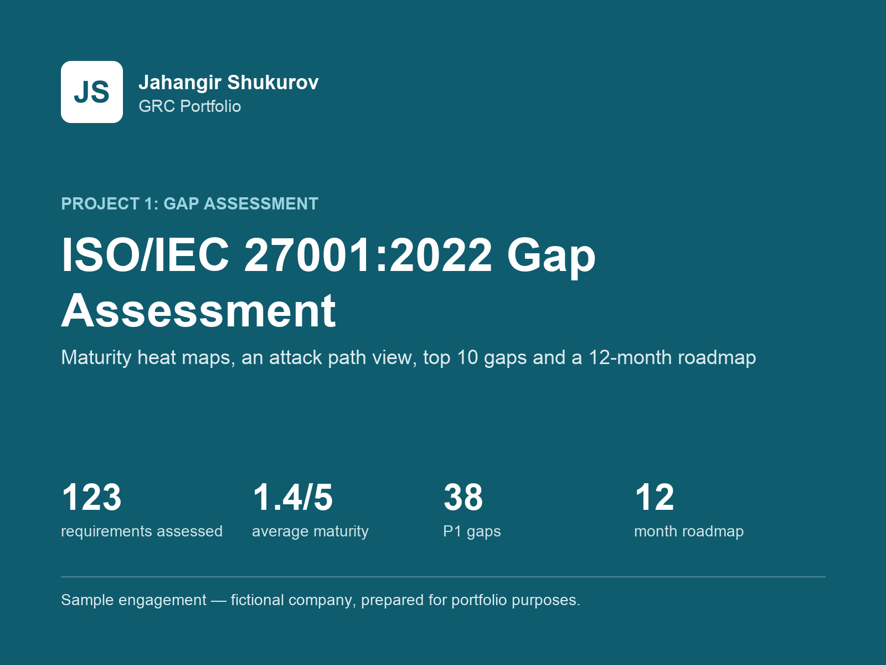
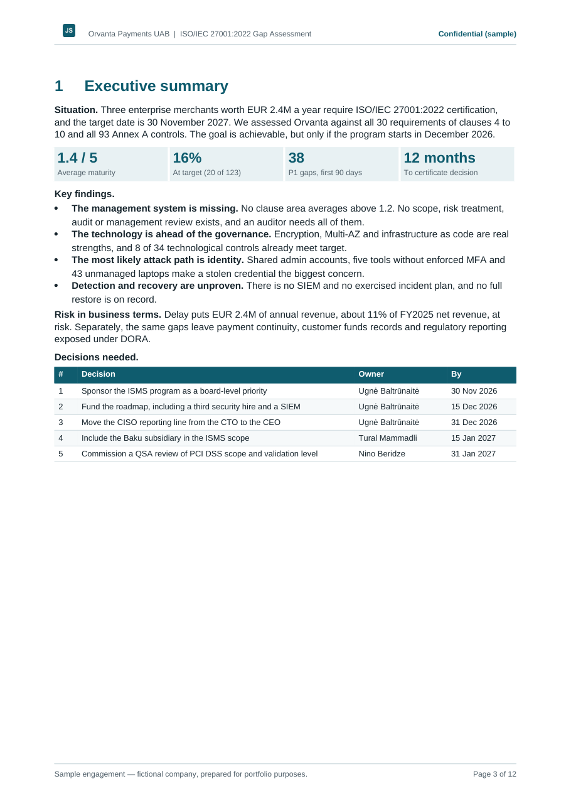
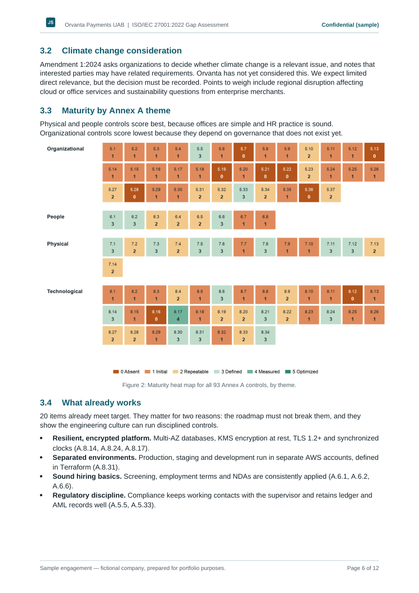
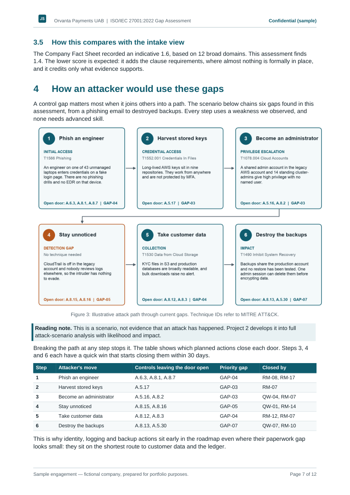
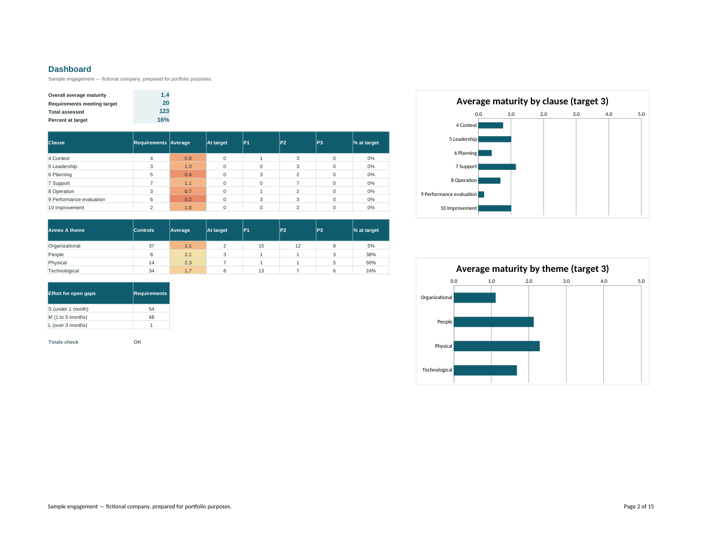
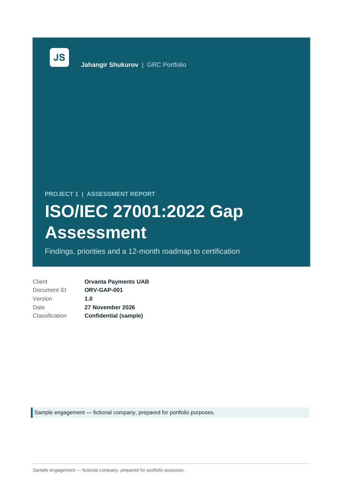
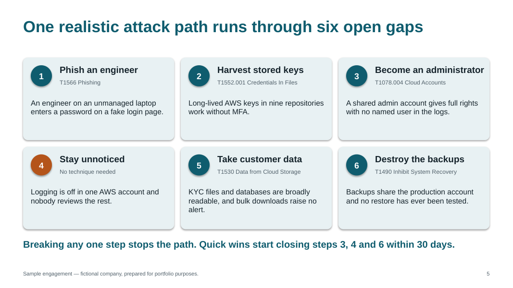

# ISO/IEC 27001:2022 Gap Assessment and Roadmap

> **Sample engagement — fictional company, prepared for portfolio purposes.** Interviews and evidence are simulated. Clause numbers, control IDs and short names are referenced; the standard's text is not reproduced.

## Client situation

Orvanta Payments UAB, a fictional EU payment institution with 120 people, must reach certification by 30 November 2027. Three enterprise merchants worth EUR 2.4M a year have made it a contract condition, and DORA already applies.

## Objectives

- Measure Orvanta against every requirement of clauses 4 to 10 and all 93 Annex A controls.
- Turn the results into priorities leadership can act on.
- Provide a realistic 12-month route to a certificate decision.

## Approach

- **Scope and evidence:** 13 simulated interviews and 22 documents, each logged in an evidence register.
- **Scoring:** a defined 0 to 5 maturity scale, with level 3 as the certification target.
- **Threat-informed priorities:** the priority score combines gap size, certification blocker status and attack relevance. Weights are editable in the workbook.
- **Attack path analysis:** six observed gaps are chained into one illustrative path, from phishing to destroyed backups, mapped to MITRE ATT&CK and to the actions that close each step.
- **Amendment 1:2024:** the climate change consideration is assessed under clause 4.

## Deliverables

| Deliverable | Files |
|---|---|
| Assessment workbook: 123 requirements, live dashboard with charts, attack path, Gantt roadmap | [Excel](deliverables/Orvanta-ISO27001-Gap-Assessment-Workbook.xlsx) |
| Assessment report: executive summary, heat maps, attack path, top 10 gaps, quick wins, roadmap | [PDF](deliverables/Orvanta-ISO27001-Gap-Assessment-Report.pdf), [Word](deliverables/Orvanta-ISO27001-Gap-Assessment-Report.docx) |
| Eight-slide executive briefing | [PDF](deliverables/Orvanta-ISO27001-Executive-Briefing.pdf), [PowerPoint](deliverables/Orvanta-ISO27001-Executive-Briefing.pptx) |

## Key findings

- Average maturity is 1.4 out of 5, and 20 of 123 requirements (16%) meet target.
- 38 gaps are rated P1. No clause area averages above 1.2, while 8 of 34 technological controls already meet target.
- Identity is the most likely attack path: shared admin accounts, five tools without enforced MFA and 43 unmanaged laptops.
- Eight quick wins cut real risk within 30 days, and a four-phase plan reaches Stage 2 in October 2027.

## Skills and frameworks

ISO/IEC 27001:2022 and Amendment 1:2024, gap assessment, maturity modeling, threat-informed prioritization, MITRE ATT&CK, DORA awareness, remediation roadmapping, executive reporting, Excel modeling, Python automation.

## Preview

| Executive summary | Annex A heat map |
|---|---|
|  |  |

| Attack path | Workbook dashboard |
|---|---|
|  |  |

