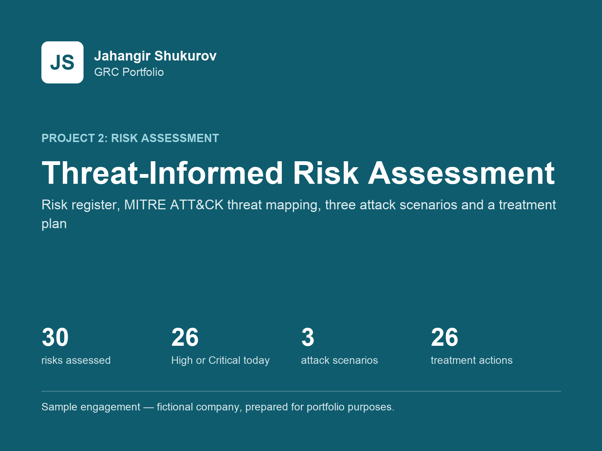
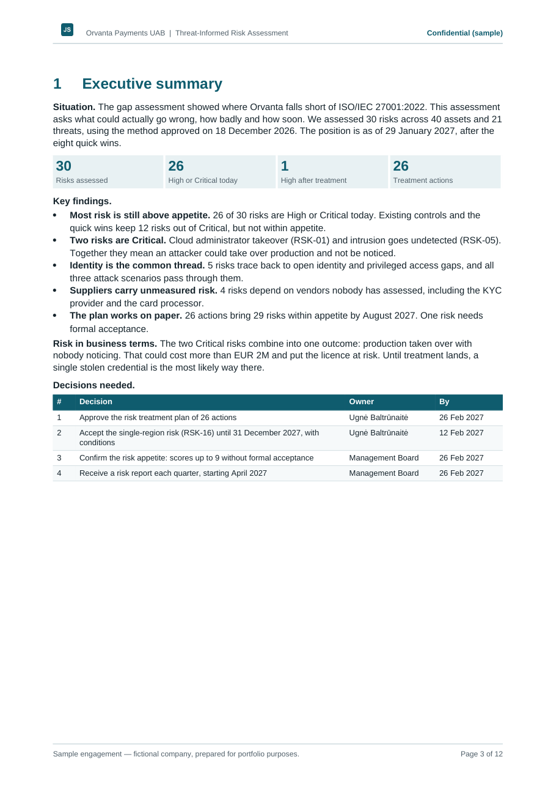
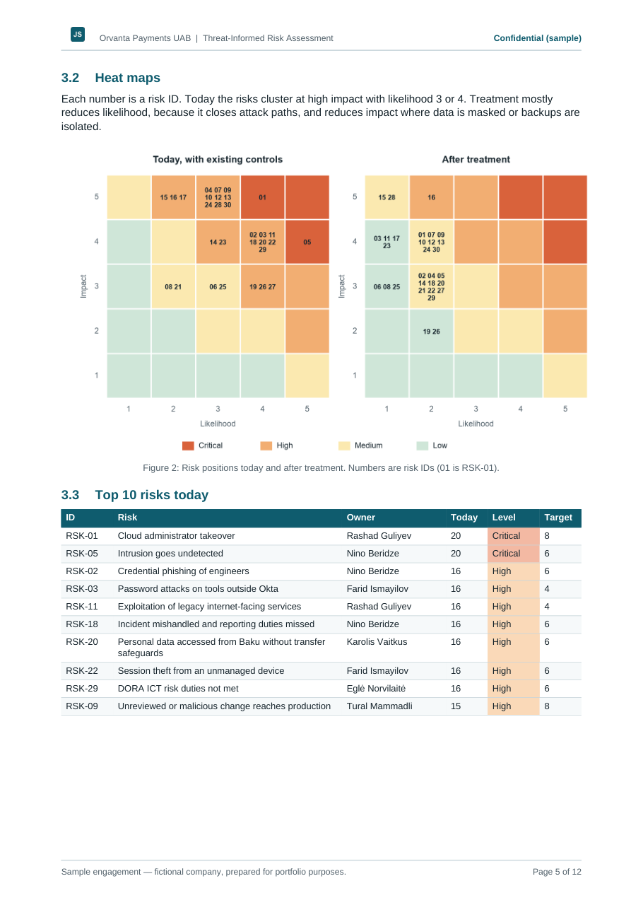
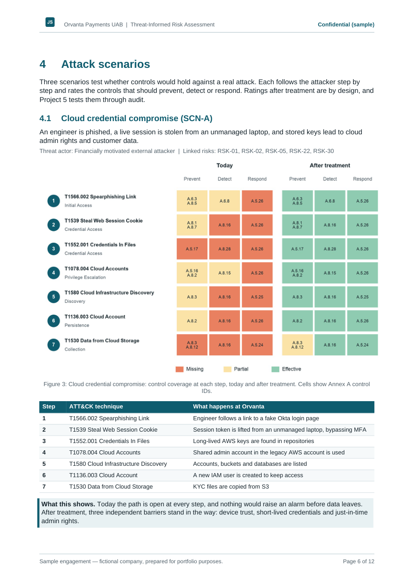
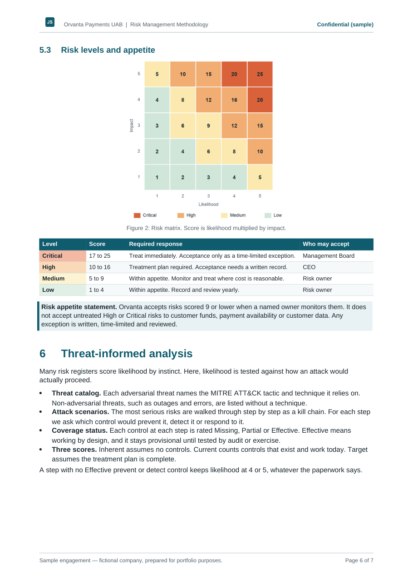
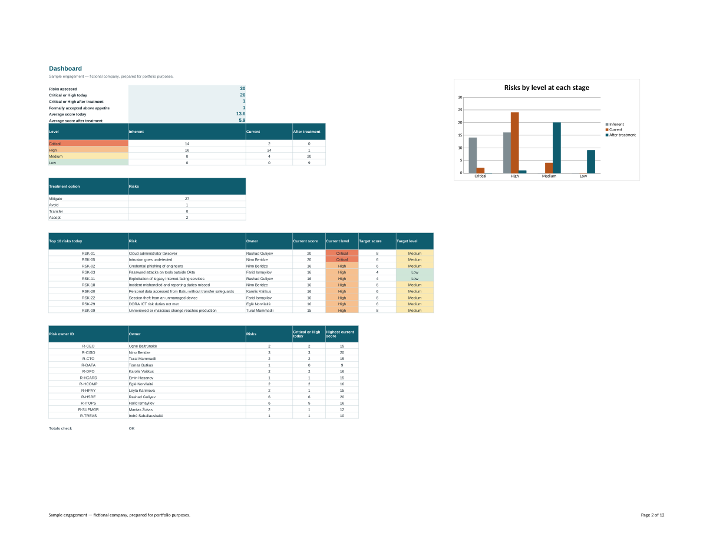

# Threat-Informed Information Security Risk Assessment

> **Sample engagement — fictional company, prepared for portfolio purposes.** Workshops and evidence are simulated. Standards are referenced by number and control ID only. Technique IDs refer to MITRE ATT&CK.

## Client situation

The [gap assessment](../01-gap-assessment/README.md) showed where Orvanta Payments UAB falls short of ISO/IEC 27001:2022. Its only risk record was a 2025 spreadsheet with no scales, owners or acceptance rules. Leadership needed to know what could actually go wrong, how badly, and what to fix first.

## Objectives

- Give Orvanta one repeatable risk method, aligned with ISO/IEC 27005:2022 and ISO/IEC 27001:2022 clause 6.1.2.
- Assess risk from the attacker's side, not only from a control checklist.
- Produce a treatment plan that joins the certification roadmap, and record what leadership accepts.

## Approach

- **Business scales:** 5x5 likelihood and impact, with impact defined in euros, regulatory consequence, customer effect and payment downtime.
- **Two ways in:** risks identified from a 40-asset register and from attack scenarios, then merged.
- **Three scores per risk:** inherent, current with existing controls, and target after treatment.
- **Threat mapping:** 15 adversarial threats mapped to MITRE ATT&CK techniques, each checked against the public knowledge base.
- **Kill-chain analysis:** three scenarios walked step by step, rating the controls that prevent, detect and respond, today and after treatment.
- **Continuity with Project 1:** every risk links to a priority gap, and every treatment action links to the roadmap.

## Deliverables

| Deliverable | Files |
|---|---|
| Risk workbook: register of 30 risks, heat maps, treatment plan, scenarios, assets, threats, live dashboard | [Excel](deliverables/Orvanta-Risk-Assessment-Workbook.xlsx) |
| Risk assessment report: executive summary, risk profile, three attack scenarios, treatment plan | [PDF](deliverables/Orvanta-Risk-Assessment-Report.pdf), [Word](deliverables/Orvanta-Risk-Assessment-Report.docx) |
| Risk management methodology: roles, process, criteria, appetite | [PDF](deliverables/Orvanta-Risk-Management-Methodology.pdf), [Word](deliverables/Orvanta-Risk-Management-Methodology.docx) |
| Risk acceptance record RA-01 | [PDF](deliverables/Orvanta-Risk-Acceptance-RA-01.pdf), [Word](deliverables/Orvanta-Risk-Acceptance-RA-01.docx) |

## Key findings

- 26 of 30 risks are High or Critical today, and two are Critical: cloud administrator takeover and undetected intrusion.
- All three attack scenarios pass through open identity and privileged access gaps.
- 26 treatment actions are designed to bring 29 risks within appetite by August 2027.
- One risk, dependence on a single AWS region, stays High and is formally accepted by the CEO for a fixed period with conditions.

## Skills and frameworks

ISO/IEC 27005:2022, ISO/IEC 27001:2022 clauses 6.1.2 and 6.1.3, MITRE ATT&CK, risk criteria and appetite design, asset and threat modeling, kill-chain analysis, risk treatment planning, risk acceptance, Excel modeling, Python automation.

## Preview

| Executive summary | Heat maps and top risks |
|---|---|
|  |  |

| Attack scenario | Risk criteria |
|---|---|
|  |  |

