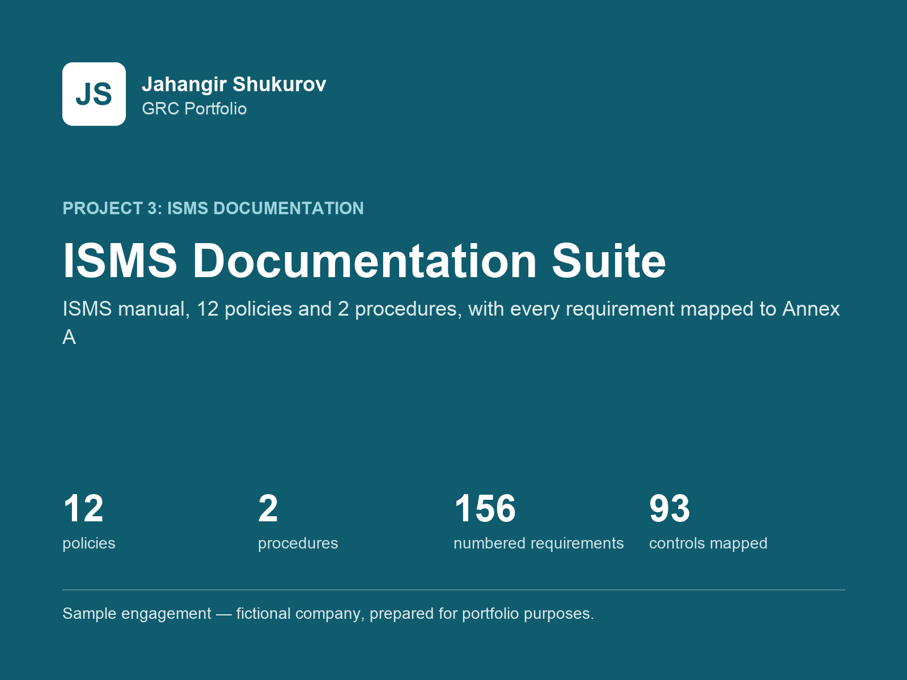
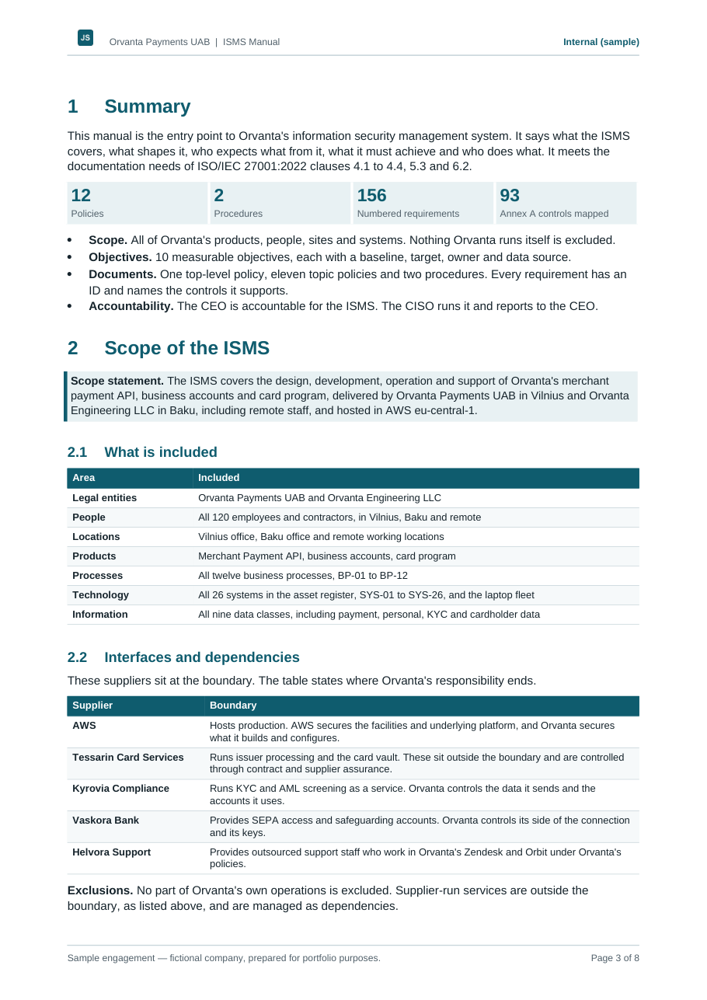
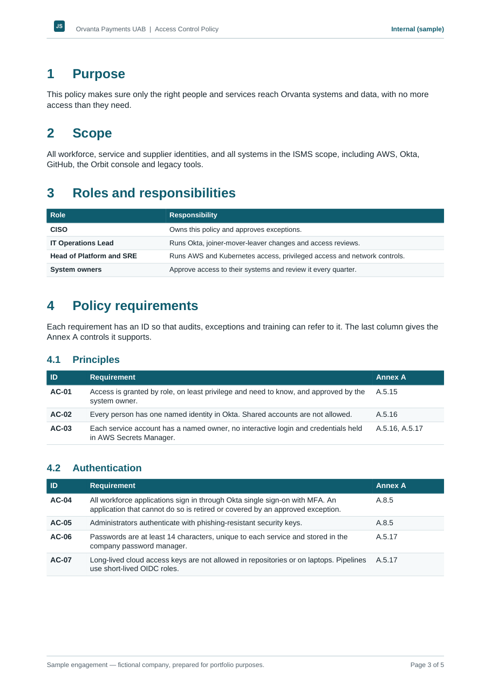
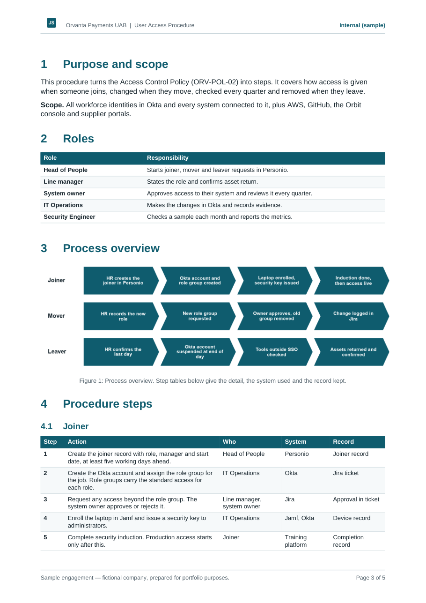
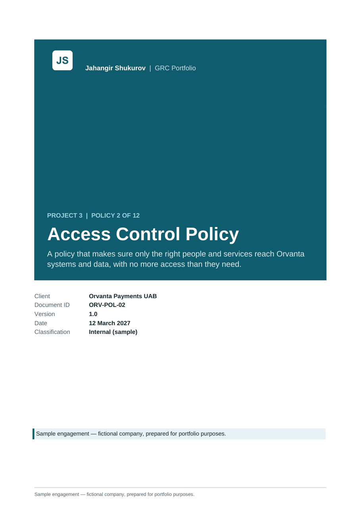
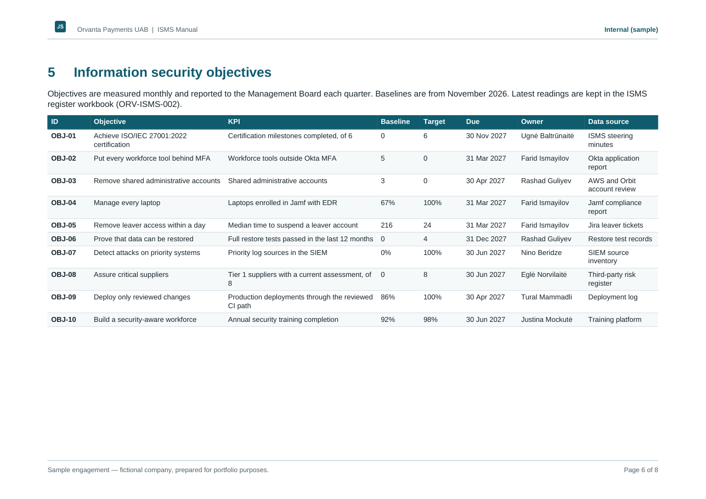
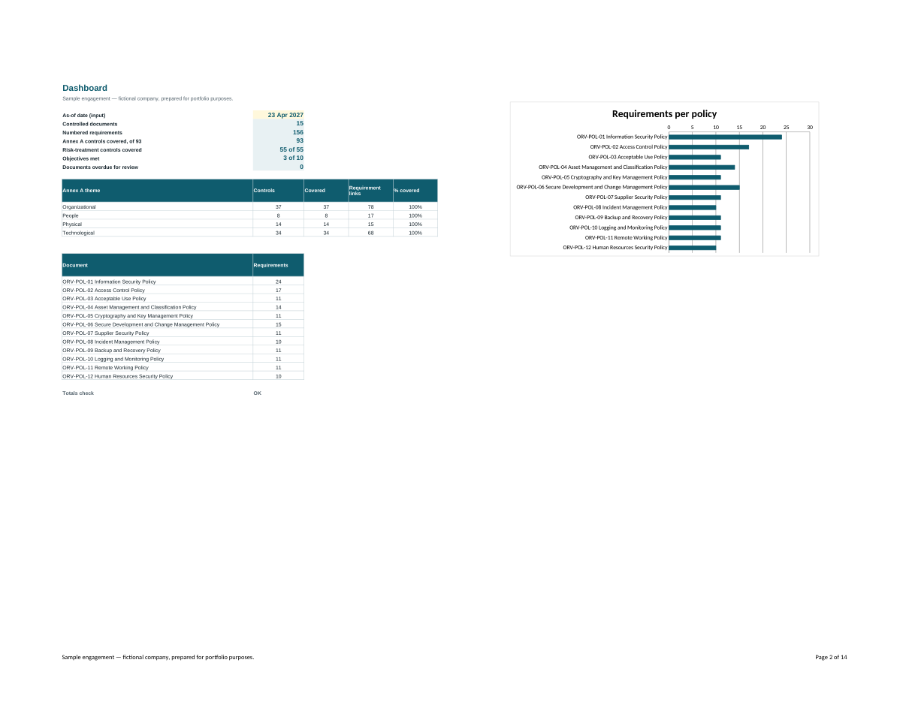

# ISMS Documentation Suite

> **Sample engagement — fictional company, prepared for portfolio purposes.** Annex A controls are referenced by ID and short name only. All policy wording is original.

## Client situation

The [gap assessment](../01-gap-assessment/README.md) found that Orvanta Payments UAB had no approved scope, objectives or policies: only a 2023 draft that was never published. The [risk assessment](../02-risk-assessment/README.md) then selected the controls Orvanta needs. Those controls had to become rules people can follow and auditors can test.

## Objectives

- Document the ISMS core: scope, context, interested parties, measurable objectives and roles.
- Write policies and procedures that are short, specific to Orvanta's tools and enforceable.
- Show that every Annex A control and every risk-treatment control is backed by a written requirement.

## Approach

- **Numbered requirements:** each policy states its rules as numbered "must" statements, such as AC-08, so audits, exceptions and training can cite them.
- **Tailored, not templated:** rules name the real mechanisms, for example Okta single sign-on, Jamf enrollment, AWS KMS and Terraform applied from CI.
- **Traceable by construction:** each requirement lists the Annex A controls it supports. The control map is generated from the requirements, and a script checks that all 93 controls are covered.
- **Measurable:** every policy carries measures with targets, and the manual sets ten objectives with baseline, target, owner and data source.
- **Amendment 1:2024:** the climate change determination is recorded in the context section.

## Deliverables

| Deliverable | Files |
|---|---|
| Complete suite in one file (71 pages) | [PDF](deliverables/Orvanta-ISMS-Documentation-Suite.pdf) |
| ISMS Manual: scope, context, interested parties, objectives, RACI | [PDF](deliverables/ORV-ISMS-001-ISMS-Manual.pdf), [Word](deliverables/ORV-ISMS-001-ISMS-Manual.docx) |
| ISMS Register: documents, 156 requirements, control map, objectives | [Excel](deliverables/ORV-ISMS-002-ISMS-Register.xlsx) |
| 12 policies | [Folder](deliverables/policies) |
| 2 procedures | [Folder](deliverables/procedures) |

### Policies

| ID | Policy | Requirements |
|---|---|---|
| ORV-POL-01 | [Information Security Policy](deliverables/policies/ORV-POL-01-Information-Security-Policy.pdf) | 24 |
| ORV-POL-02 | [Access Control Policy](deliverables/policies/ORV-POL-02-Access-Control-Policy.pdf) | 17 |
| ORV-POL-03 | [Acceptable Use Policy](deliverables/policies/ORV-POL-03-Acceptable-Use-Policy.pdf) | 11 |
| ORV-POL-04 | [Asset Management and Classification Policy](deliverables/policies/ORV-POL-04-Asset-Management-and-Classification-Policy.pdf) | 14 |
| ORV-POL-05 | [Cryptography and Key Management Policy](deliverables/policies/ORV-POL-05-Cryptography-and-Key-Management-Policy.pdf) | 11 |
| ORV-POL-06 | [Secure Development and Change Management Policy](deliverables/policies/ORV-POL-06-Secure-Development-and-Change-Management-Policy.pdf) | 15 |
| ORV-POL-07 | [Supplier Security Policy](deliverables/policies/ORV-POL-07-Supplier-Security-Policy.pdf) | 11 |
| ORV-POL-08 | [Incident Management Policy](deliverables/policies/ORV-POL-08-Incident-Management-Policy.pdf) | 10 |
| ORV-POL-09 | [Backup and Recovery Policy](deliverables/policies/ORV-POL-09-Backup-and-Recovery-Policy.pdf) | 11 |
| ORV-POL-10 | [Logging and Monitoring Policy](deliverables/policies/ORV-POL-10-Logging-and-Monitoring-Policy.pdf) | 11 |
| ORV-POL-11 | [Remote Working Policy](deliverables/policies/ORV-POL-11-Remote-Working-Policy.pdf) | 11 |
| ORV-POL-12 | [Human Resources Security Policy](deliverables/policies/ORV-POL-12-Human-Resources-Security-Policy.pdf) | 10 |

### Procedures

| ID | Procedure |
|---|---|
| ORV-PRC-01 | [User Access Procedure](deliverables/procedures/ORV-PRC-01-User-Access-Procedure.pdf): provisioning, review and offboarding in 19 steps |
| ORV-PRC-02 | [Vulnerability and Patch Management Procedure](deliverables/procedures/ORV-PRC-02-Vulnerability-and-Patch-Management-Procedure.pdf): 12 steps with remediation deadlines |

## Key outcomes

- 15 controlled documents with owners, approvers and review dates.
- 156 numbered requirements covering all 93 Annex A controls, including all 55 controls selected in risk treatment.
- Ten objectives with numeric baselines and targets, three of them met by April 2027.
- A control map ready to feed the Statement of Applicability.

## Skills and frameworks

ISO/IEC 27001:2022 clauses 4 to 7 and Annex A, policy and procedure writing, ISMS scoping, objective and KPI design, RACI, control mapping, document control, Excel modeling, Python automation.

## Preview

| ISMS scope | Policy requirements |
|---|---|
|  |  |

| Procedure | Policy cover |
|---|---|
|  |  |

