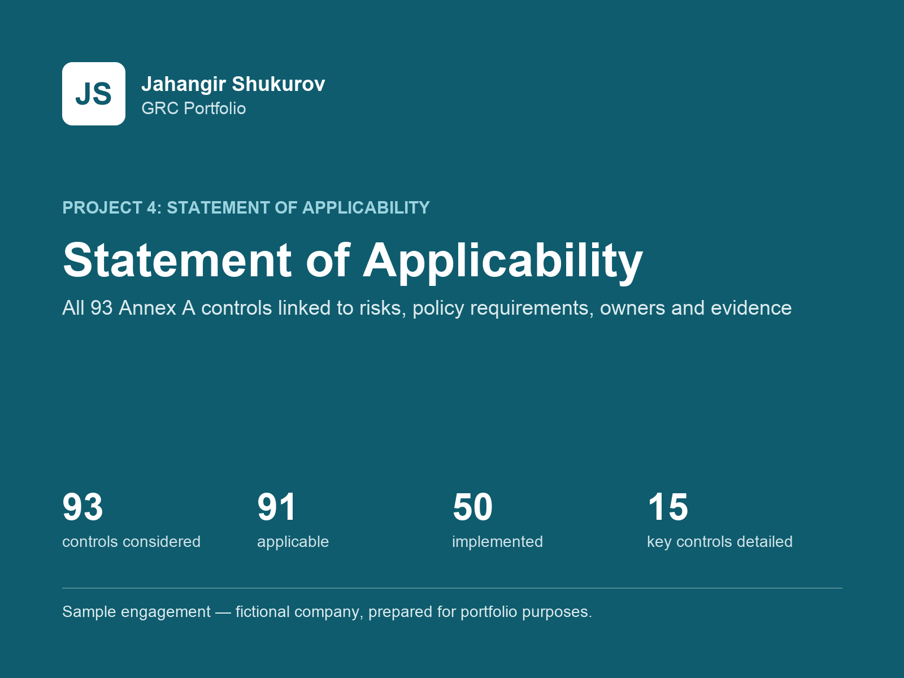
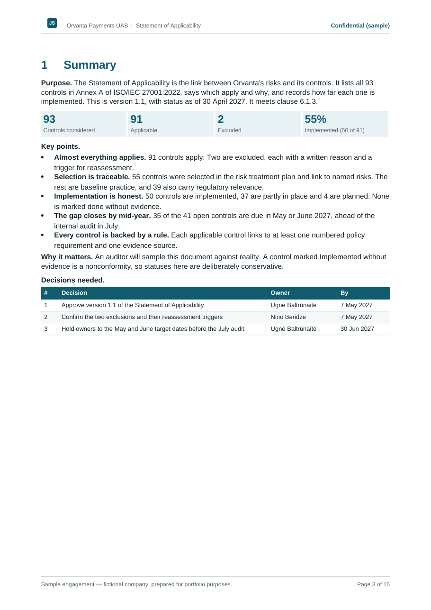
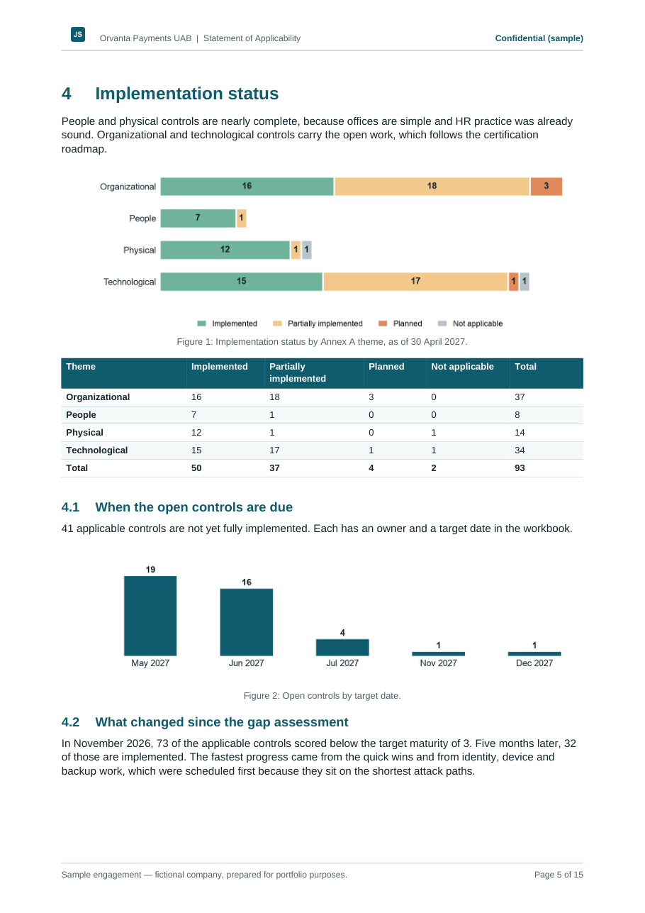
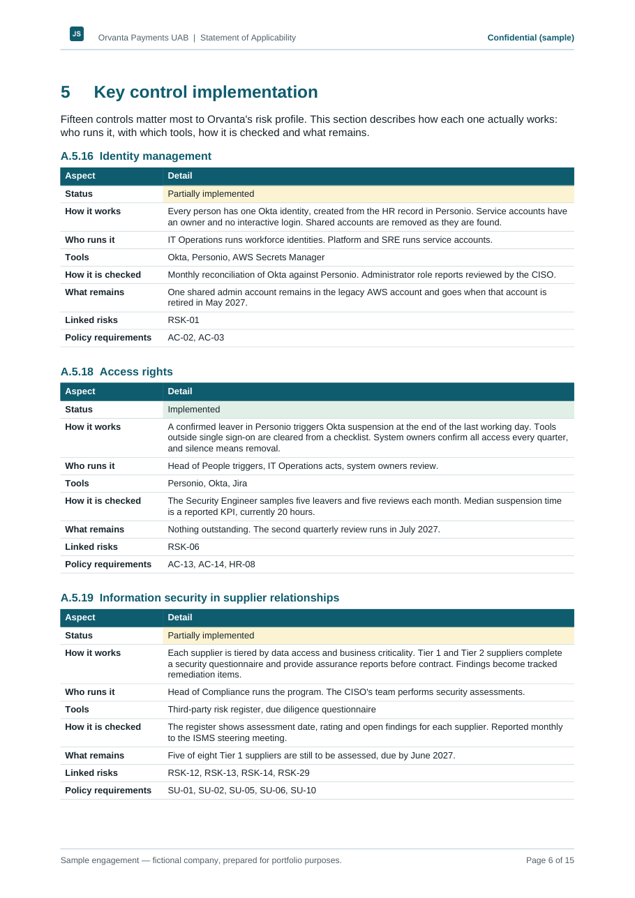
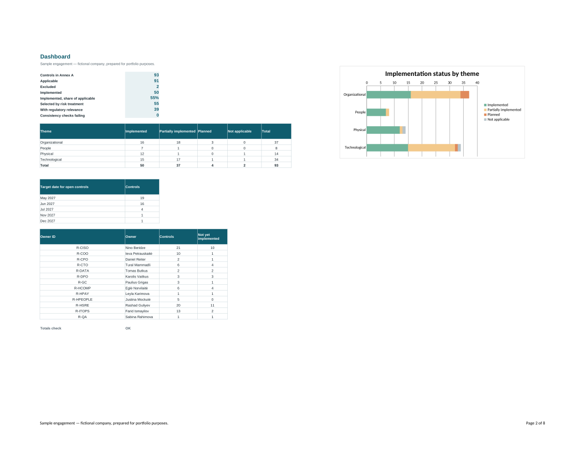
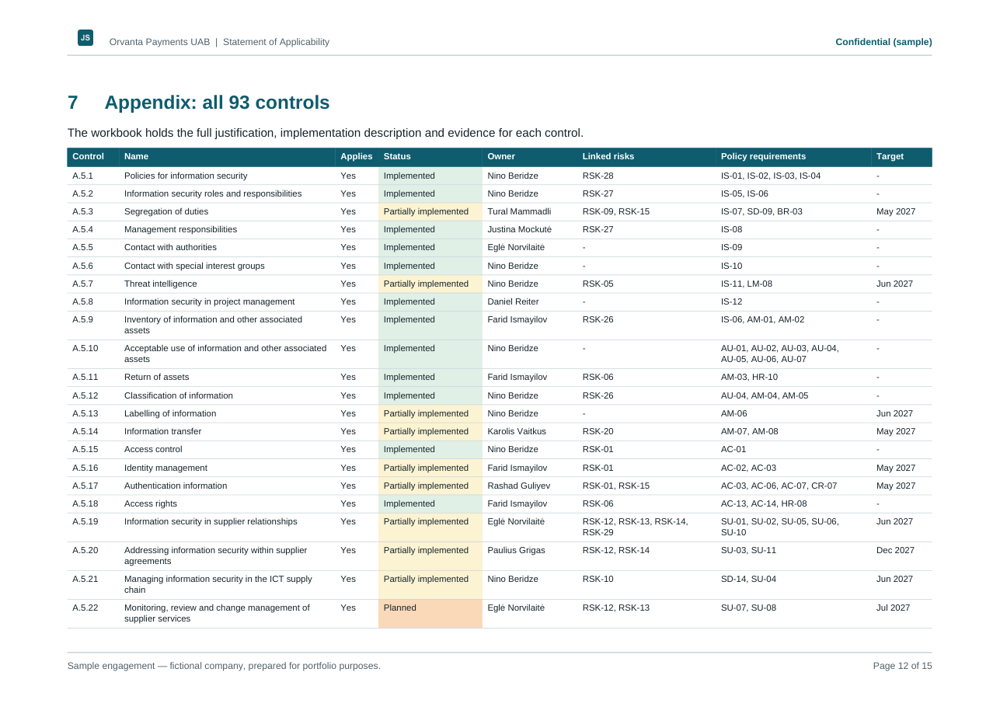

# Statement of Applicability and Control Implementation Matrix

> **Sample engagement — fictional company, prepared for portfolio purposes.** Evidence and status are simulated. Annex A controls are referenced by ID and short name only.

## Client situation

Orvanta Payments UAB had assessed its risks and written its policies. An ISO/IEC 27001:2022 auditor would now ask one question of every Annex A control: does it apply, why, and can you prove it works? Without a Statement of Applicability, certification cannot proceed.

## Objectives

- Decide the applicability of all 93 Annex A controls, with a reason for each.
- Record implementation status honestly, with an owner, evidence and target date.
- Link every control to the risks it treats and the policy requirements that enforce it.

## Approach

- **Three-question test:** does a risk need the control, does a law or contract expect it, or is it baseline practice Orvanta needs anyway.
- **Derived links:** linked risks come from the [risk register](../02-risk-assessment/README.md) and policy requirements from the [ISMS register](../03-isms-documentation/README.md). A script checks that every ID exists.
- **Conservative status:** Implemented, Partially implemented or Planned, as of 30 April 2027. Nothing is marked done without an evidence source.
- **Justified exclusions:** two controls are excluded, each with a reason and a trigger for reassessment.
- **Key controls in depth:** fifteen controls described as they actually operate: who runs them, with which tools, how they are checked and what remains.

## Deliverables

| Deliverable | Files |
|---|---|
| SoA workbook: 93 controls, key controls, evidence register, live dashboard | [Excel](deliverables/Orvanta-Statement-of-Applicability.xlsx) |
| SoA document: summary, method, exclusions, status, 15 key controls, full appendix | [PDF](deliverables/Orvanta-Statement-of-Applicability.pdf), [Word](deliverables/Orvanta-Statement-of-Applicability.docx) |

## Key outcomes

- 91 of 93 controls apply. A.7.6 and A.8.30 are excluded with written reasons.
- 55 controls were selected by risk treatment and link to named risks. 39 carry regulatory relevance.
- 50 controls are implemented, 37 partly and 4 planned. 35 of the 41 open controls are due in May or June 2027, before the internal audit.
- Every applicable control links to at least one numbered policy requirement and one of 34 evidence sources.

## Skills and frameworks

ISO/IEC 27001:2022 clause 6.1.3 and Annex A, Statement of Applicability, control selection and justification, implementation tracking, evidence mapping, traceability across risk, policy and control, Excel modeling, Python automation.

## Preview

| Summary | Implementation status |
|---|---|
|  |  |

| Key controls | Workbook dashboard |
|---|---|
|  |  |

