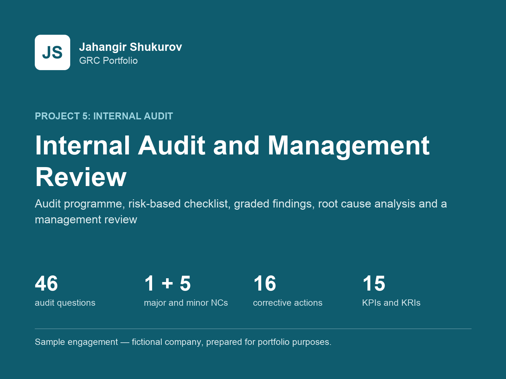
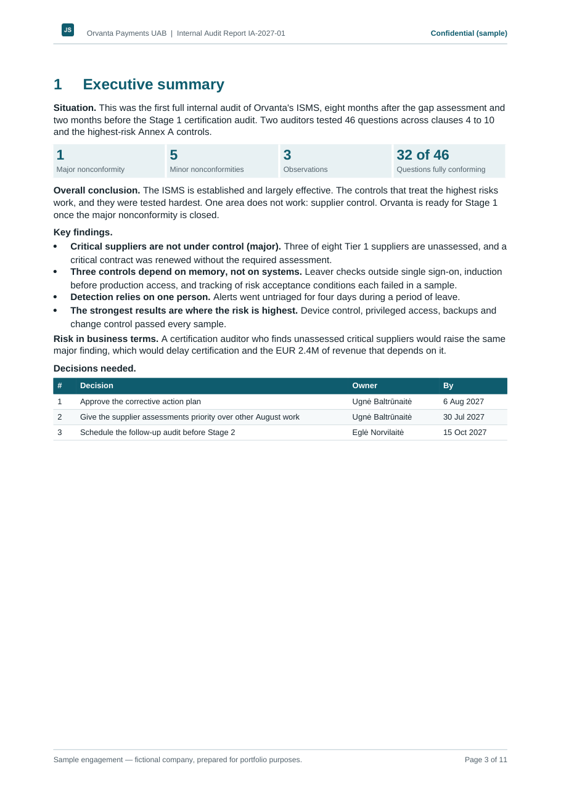
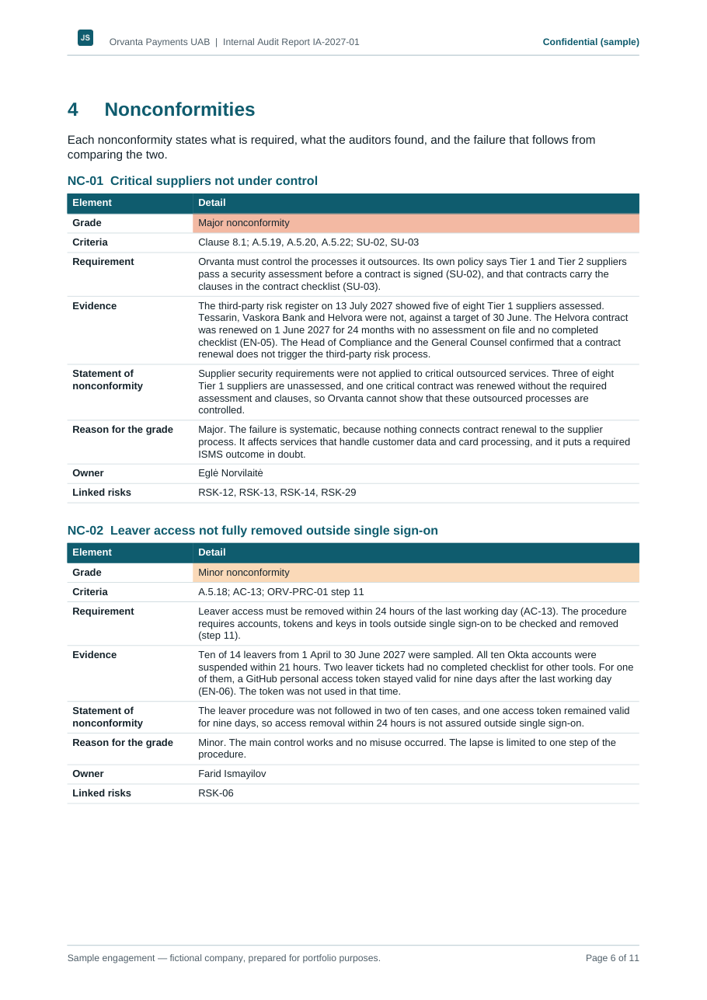
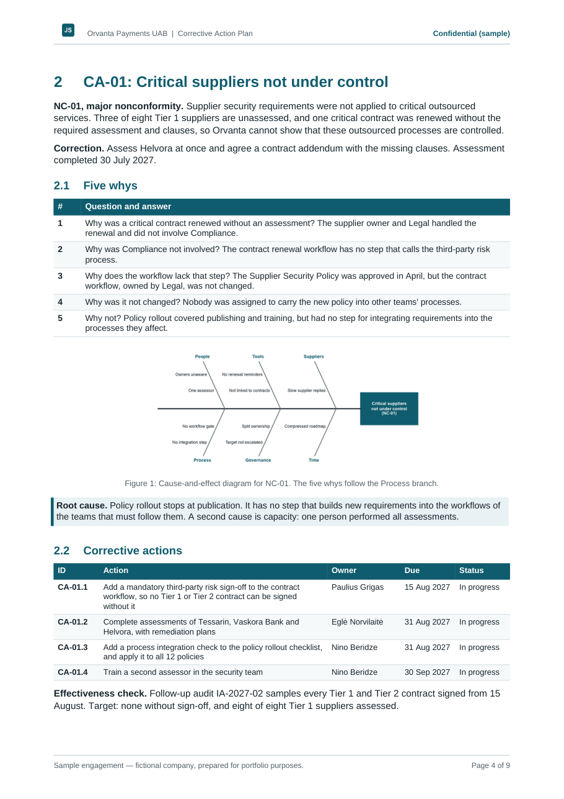
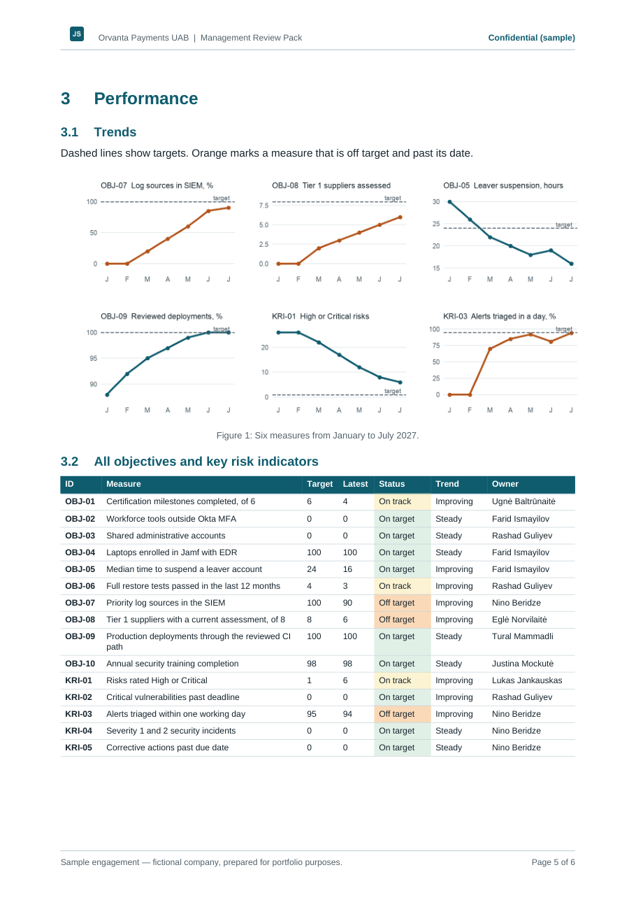
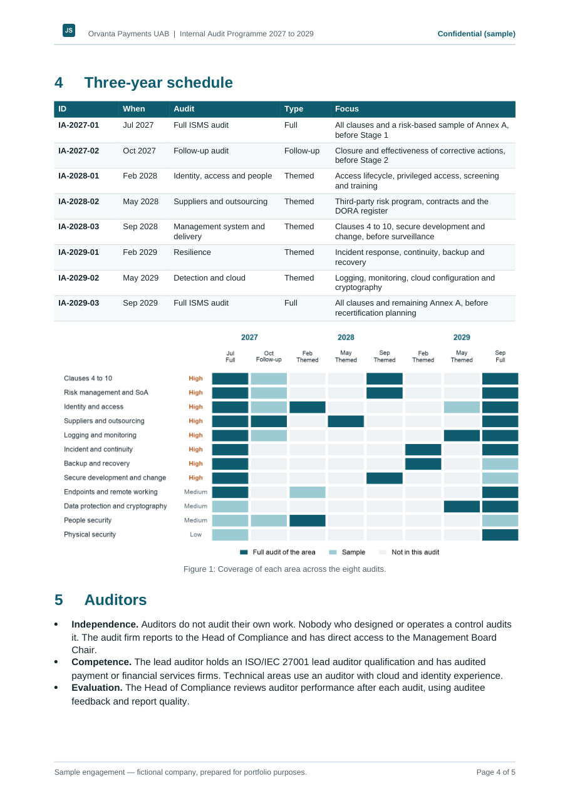
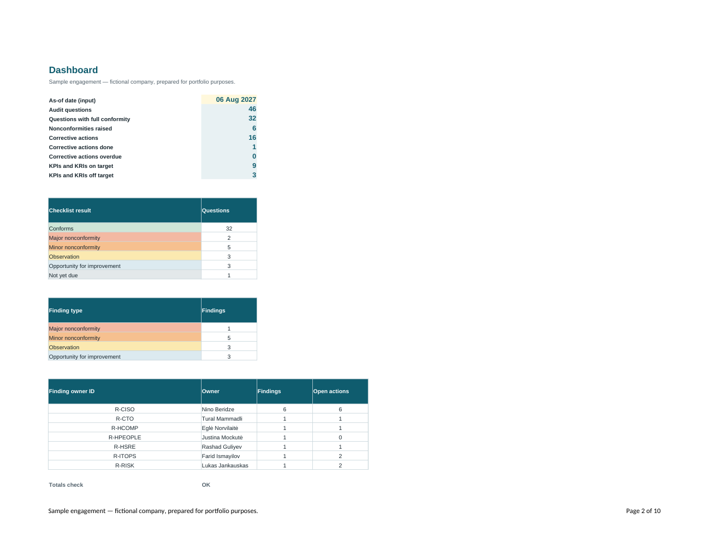

# Internal Audit and Management Review

> **Sample engagement — fictional company, prepared for portfolio purposes.** Audit evidence, samples, the audit team and the meeting are simulated. Standards are referenced by clause number and control ID only.
>
> **Independence note:** one author prepared both the implementation documents (Projects 1 to 4) and these audit documents, to show both skills. In a real engagement, the people who build an ISMS do not audit it. Here the audit is carried out by a fictional external team.

## Client situation

By July 2027, Orvanta Payments UAB had a risk assessment, 12 policies and a Statement of Applicability. Two months before its Stage 1 certification audit, it needed to know whether the ISMS actually worked, and its leadership had never formally reviewed it. ISO/IEC 27001:2022 clauses 9.2 and 9.3 require both.

## Objectives

- Plan internal audits for three years on a risk basis.
- Audit the full ISMS and report findings an owner can act on and a certification auditor would accept.
- Find root causes, not symptoms, and plan corrective actions.
- Give top management the inputs for a real management review, and record its decisions.

## Approach

- **ISO 19011 and ISO/IEC 27007 as guides:** programme, plan, sampling, evidence, findings and follow-up.
- **Risk-based sampling:** larger samples where risk is higher. Auditors choose the samples, not auditees.
- **Findings in three parts:** every nonconformity states the requirement, the evidence and the failure that follows, and cites Orvanta's own numbered policy requirements.
- **Root cause by five whys:** with a cause-and-effect diagram for the major finding. Two findings turned out to share one cause.
- **Honest performance data:** the KPI dashboard shows missed targets as clearly as met ones.

## Deliverables

| Deliverable | Files |
|---|---|
| Internal audit programme 2027 to 2029 | [PDF](deliverables/ORV-AUD-001-Internal-Audit-Programme.pdf), [Word](deliverables/ORV-AUD-001-Internal-Audit-Programme.docx) |
| Audit plan IA-2027-01 with schedule and sampling | [PDF](deliverables/ORV-AUD-002-Audit-Plan-IA-2027-01.pdf), [Word](deliverables/ORV-AUD-002-Audit-Plan-IA-2027-01.docx) |
| Audit report with graded findings | [PDF](deliverables/ORV-AUD-003-Internal-Audit-Report-IA-2027-01.pdf), [Word](deliverables/ORV-AUD-003-Internal-Audit-Report-IA-2027-01.docx) |
| Corrective action plan with root cause analysis | [PDF](deliverables/ORV-AUD-004-Corrective-Action-Plan.pdf), [Word](deliverables/ORV-AUD-004-Corrective-Action-Plan.docx) |
| Audit workbook: checklist, evidence notes, findings, CAPA tracker, KPI and KRI dashboard | [Excel](deliverables/Orvanta-Internal-Audit-Workbook.xlsx) |
| Management review pack | [PDF](deliverables/ORV-MR-001-Management-Review-Pack.pdf), [Word](deliverables/ORV-MR-001-Management-Review-Pack.docx) |
| Management review minutes | [PDF](deliverables/ORV-MR-002-Management-Review-Minutes.pdf), [Word](deliverables/ORV-MR-002-Management-Review-Minutes.docx) |

## Key findings

- 46 risk-based audit questions: 32 fully conforming, 1 major and 5 minor nonconformities, 3 observations, 3 opportunities for improvement.
- The major finding: three of eight critical suppliers were unassessed and a critical contract was renewed without the required assessment.
- The pattern behind the findings: requirements built into a system held, and requirements that relied on memory failed.
- The controls on the shortest attack paths, including device control, privileged access, backups and change control, passed every sample.
- Management review: 7 decisions and 8 actions, including Stage 1 going ahead only once the major finding is closed.

## Skills and frameworks

ISO/IEC 27001:2022 clauses 9.1, 9.2, 9.3 and 10, ISO 19011:2018, ISO/IEC 27007, audit programme design, risk-based sampling, nonconformity writing, root cause analysis (five whys, cause-and-effect), corrective action planning, KPI and KRI design, management review facilitation.

## Preview

| Audit report summary | Nonconformity write-up |
|---|---|
|  |  |

| Root cause analysis | KPI trends |
|---|---|
|  |  |

