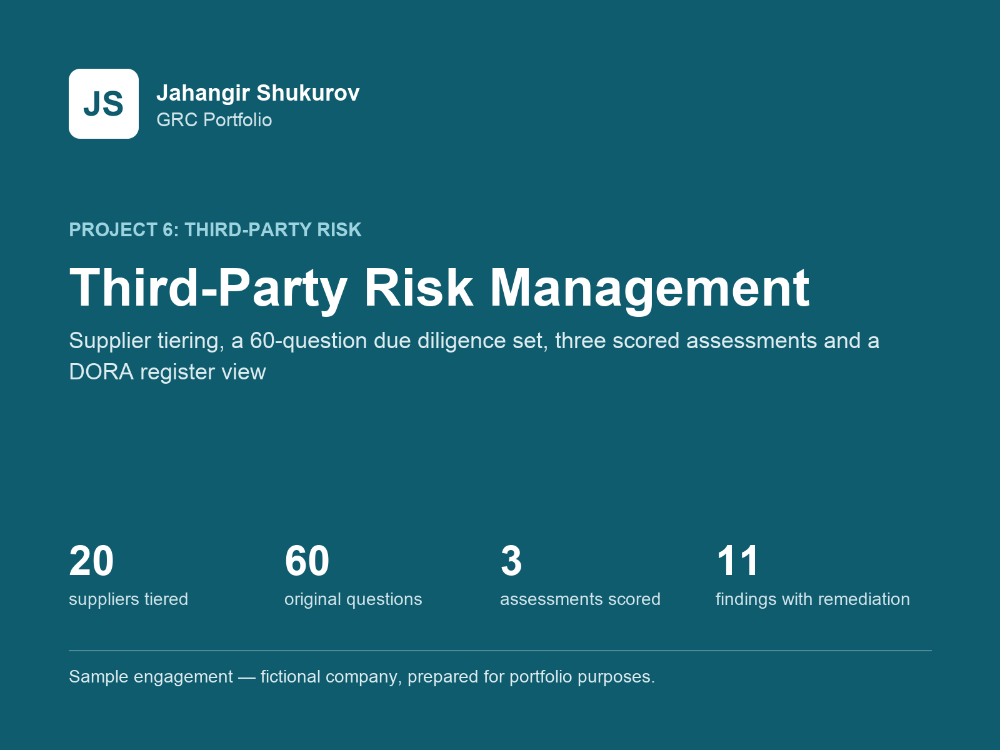
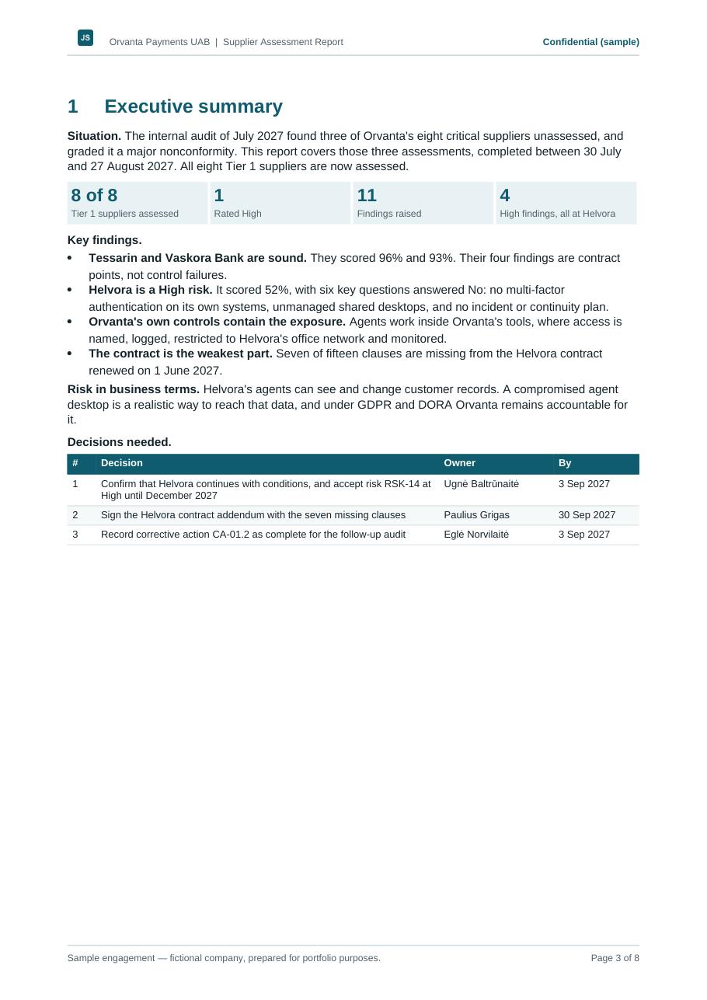
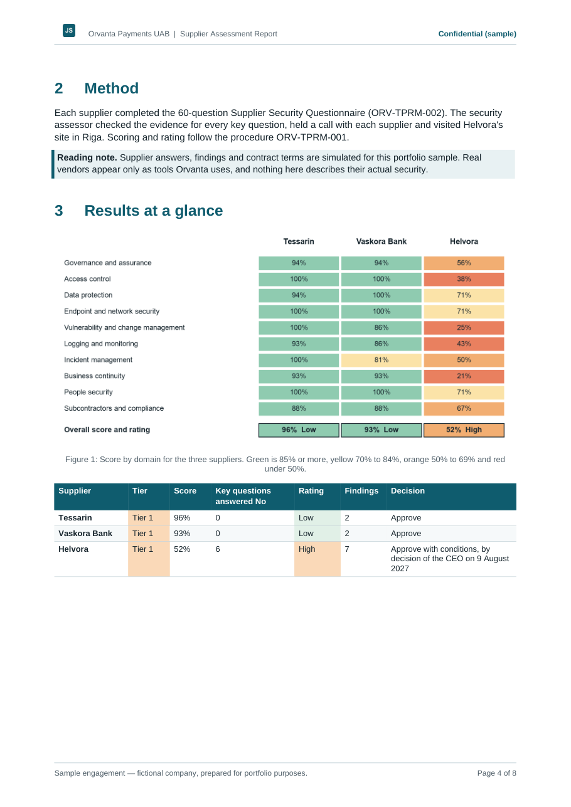
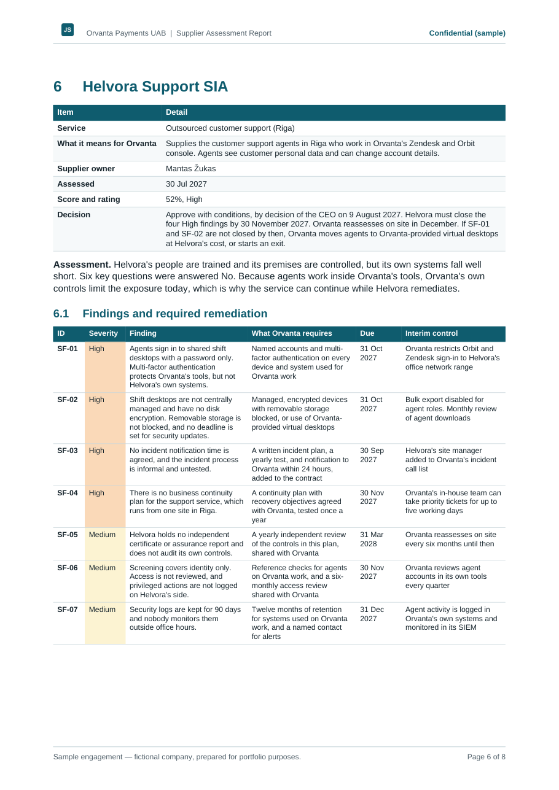
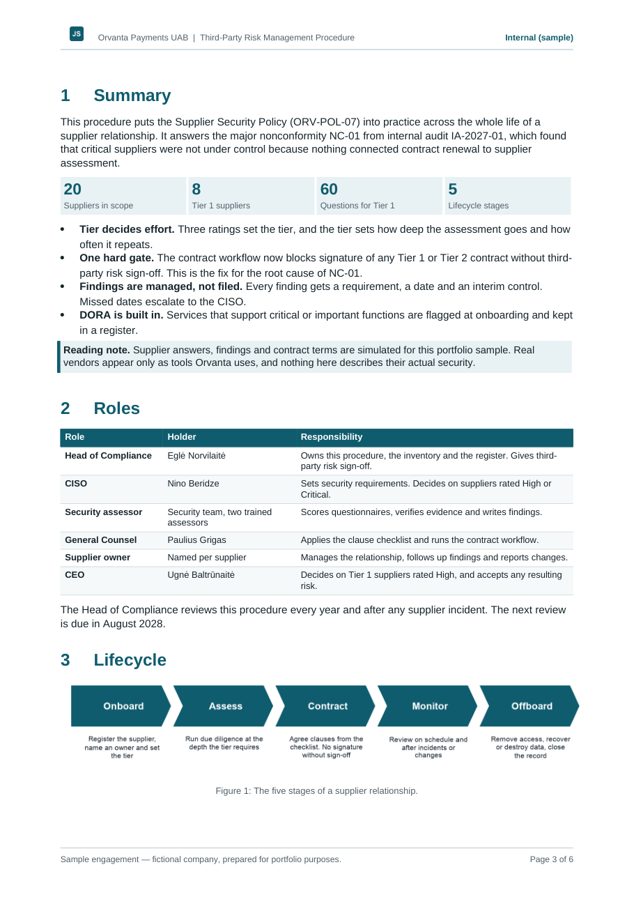
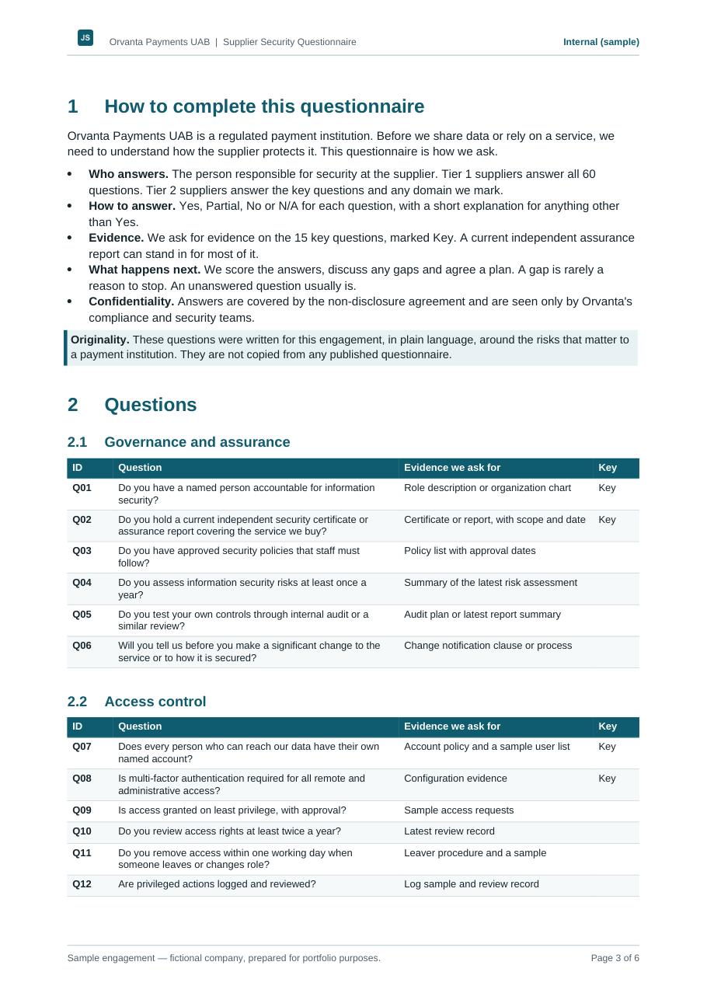
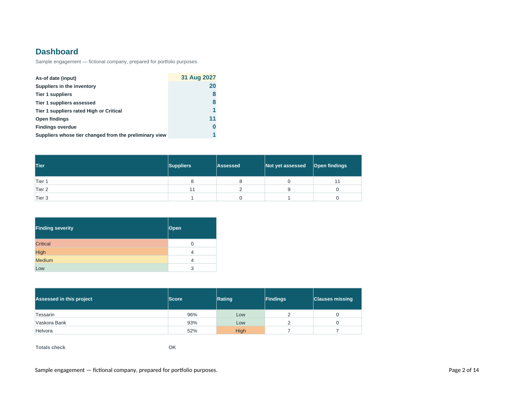

# Third-Party Risk Management Program

> **Sample engagement — fictional company, prepared for portfolio purposes.** Supplier answers, findings and contract terms are simulated. Real vendors appear only as tools the fictional company uses, and nothing here describes their actual security. The questionnaire is original and is not copied from any published set.

## Client situation

The [internal audit](../05-internal-audit-management-review/README.md) of July 2027 found that three of Orvanta Payments UAB's eight critical suppliers had never been assessed, and that a critical contract had been renewed with no security review. It graded this a major nonconformity, two months before the Stage 1 certification audit. As a financial entity under DORA, Orvanta also has to keep a register of its ICT suppliers.

## Objectives

- Fix the root cause: connect contract signature to supplier assessment.
- Tier all 20 suppliers by a rule anyone can apply.
- Assess the three unassessed critical suppliers and decide what to do about each.
- Record the ICT services that support critical or important functions.

## Approach

- **Full lifecycle:** onboarding, due diligence, contracting, monitoring and offboarding, in 16 steps with a named record for each.
- **Calculated tiering:** three ratings for data sensitivity, business criticality and system access. The workbook sets the tier.
- **Original questionnaire:** 60 plain-language questions in 10 domains. Fifteen key questions carry double weight, and a No on any of them caps the rating at High.
- **Findings that can be managed:** each has a required fix, a due date and an interim control that Orvanta runs itself.
- **Verified regulation:** DORA provisions are cited only where confirmed, and the rest are flagged for verification inside the document.

## Deliverables

| Deliverable | Files |
|---|---|
| Third-party risk workbook: inventory, tiering, questionnaire, scored assessments, findings, contract checklist, register | [Excel](deliverables/Orvanta-Third-Party-Risk-Workbook.xlsx) |
| Third-Party Risk Management Procedure | [PDF](deliverables/ORV-TPRM-001-Third-Party-Risk-Management-Procedure.pdf), [Word](deliverables/ORV-TPRM-001-Third-Party-Risk-Management-Procedure.docx) |
| Supplier Security Questionnaire | [PDF](deliverables/ORV-TPRM-002-Supplier-Security-Questionnaire.pdf), [Word](deliverables/ORV-TPRM-002-Supplier-Security-Questionnaire.docx) |
| Supplier Assessment Report: three assessments | [PDF](deliverables/ORV-TPRM-003-Supplier-Assessment-Report.pdf), [Word](deliverables/ORV-TPRM-003-Supplier-Assessment-Report.docx) |

## Key findings

- All eight Tier 1 suppliers are now assessed, which closes the audit's corrective action.
- The card processor and the bank scored 96% and 93%. Their four findings are contract points.
- The outsourced support provider scored 52% and is rated High: no multi-factor authentication on its own systems, unmanaged shared desktops, and no incident or continuity plan.
- It continues with conditions, because Orvanta's own controls contain the exposure while the supplier remediates against fixed dates.
- Seven of fifteen required clauses were missing from that supplier's contract. A workflow gate now blocks signature without sign-off.

## Skills and frameworks

Third-party risk management, supplier tiering, due diligence questionnaire design, risk scoring, remediation planning, contract security clauses, DORA ICT third-party risk and register of information, ISO/IEC 27001:2022 controls A.5.19 to A.5.23, Excel modeling, Python automation.

## Preview

| Assessment summary | Scores by domain |
|---|---|
|  |  |

| High-risk supplier | Lifecycle procedure |
|---|---|
|  |  |

