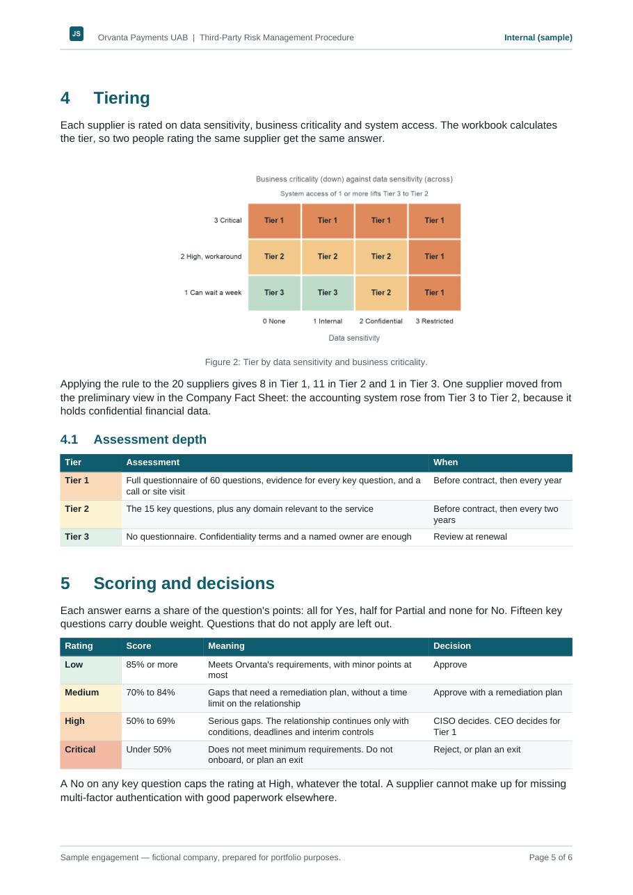

# Third-Party Risk Management Program

> **Sample engagement — fictional company, prepared for portfolio purposes.** Real vendors appear only as tools the fictional company uses, and nothing here describes their actual security. The questionnaire is original and is not copied from any published set.

**Status: in progress.** The procedure and the questionnaire are published. The workbook and the scored supplier assessments follow.

## Client situation

The [internal audit](../05-internal-audit-management-review/README.md) of July 2027 found that three of Orvanta Payments UAB's eight critical suppliers had never been assessed, and that a critical contract had been renewed with no security review. It graded this a major nonconformity, two months before the Stage 1 certification audit. As a financial entity under DORA, Orvanta also has to keep a register of its ICT suppliers.

## Objectives

- Fix the root cause: connect contract signature to supplier assessment.
- Tier all 20 suppliers by a rule anyone can apply.
- Assess the three unassessed critical suppliers and decide what to do about each.
- Record the ICT services that support critical or important functions.

## Approach

- **Full lifecycle:** onboarding, due diligence, contracting, monitoring and offboarding, in 16 steps with a named record for each.
- **Calculated tiering:** three ratings for data sensitivity, business criticality and system access set the tier.
- **Original questionnaire:** 60 plain-language questions in 10 domains. Fifteen key questions carry double weight, and a No on any of them caps the rating at High.
- **Verified regulation:** DORA provisions are cited only where confirmed, and the rest are flagged for verification inside the document.

## Deliverables

| Deliverable | Files |
|---|---|
| Third-Party Risk Management Procedure | [PDF](deliverables/ORV-TPRM-001-Third-Party-Risk-Management-Procedure.pdf), [Word](deliverables/ORV-TPRM-001-Third-Party-Risk-Management-Procedure.docx) |
| Supplier Security Questionnaire | [PDF](deliverables/ORV-TPRM-002-Supplier-Security-Questionnaire.pdf), [Word](deliverables/ORV-TPRM-002-Supplier-Security-Questionnaire.docx) |
| Third-party risk workbook and Supplier Assessment Report | In progress |

## Preview

| Lifecycle procedure | Tiering rule |
|---|---|
|  |  |

