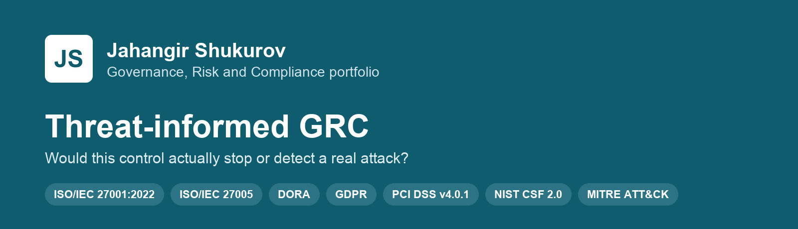
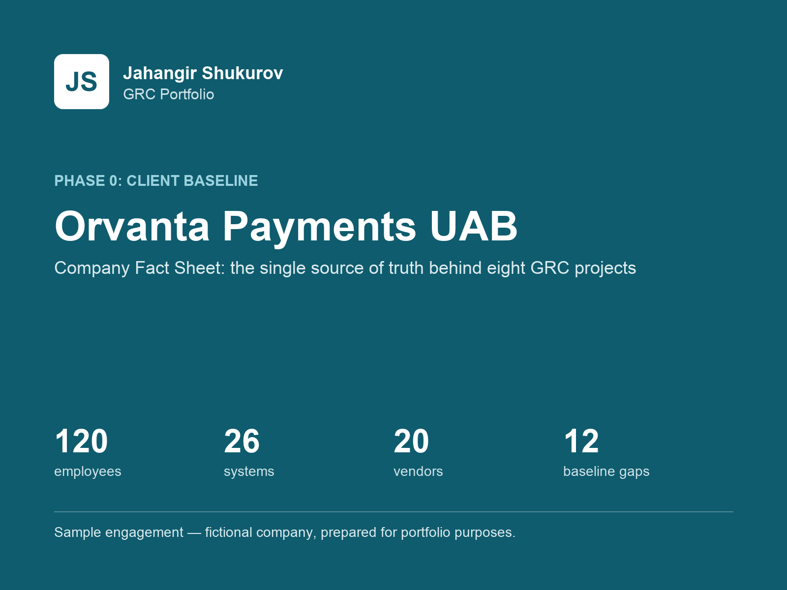
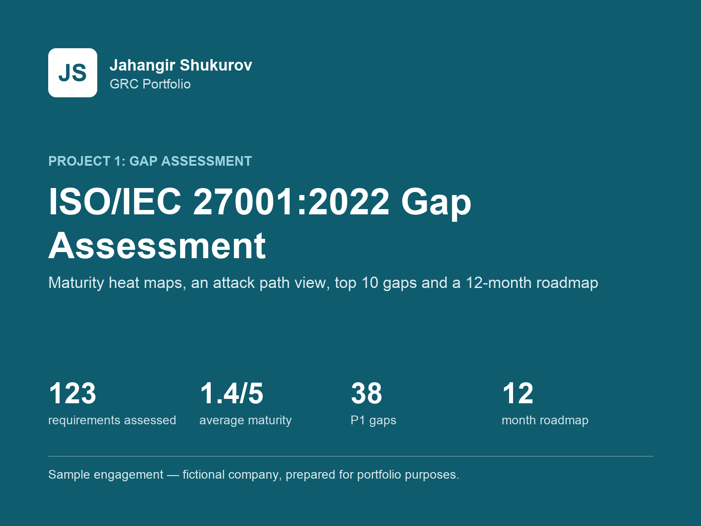
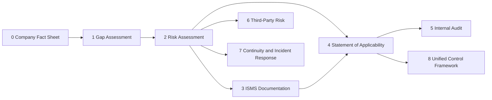
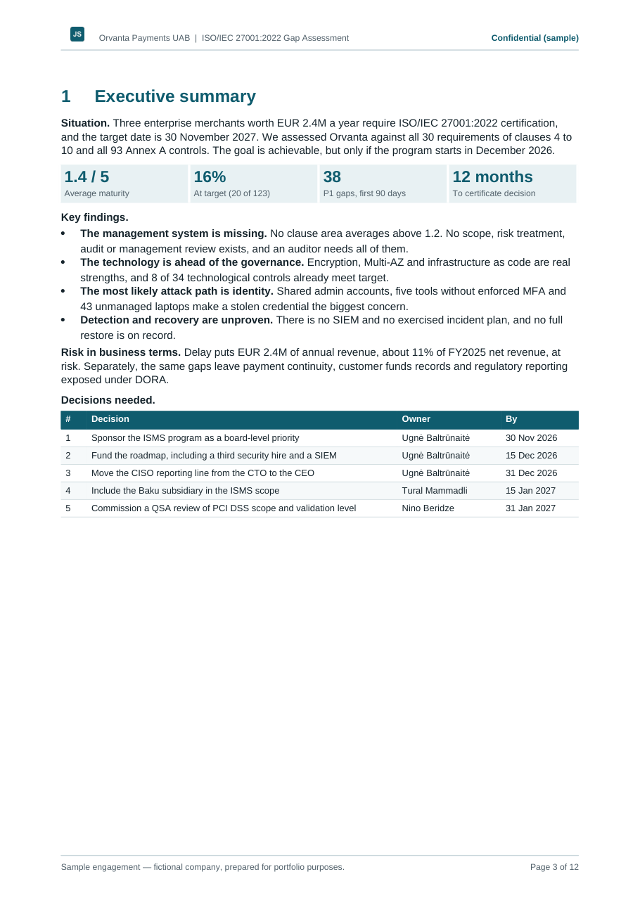
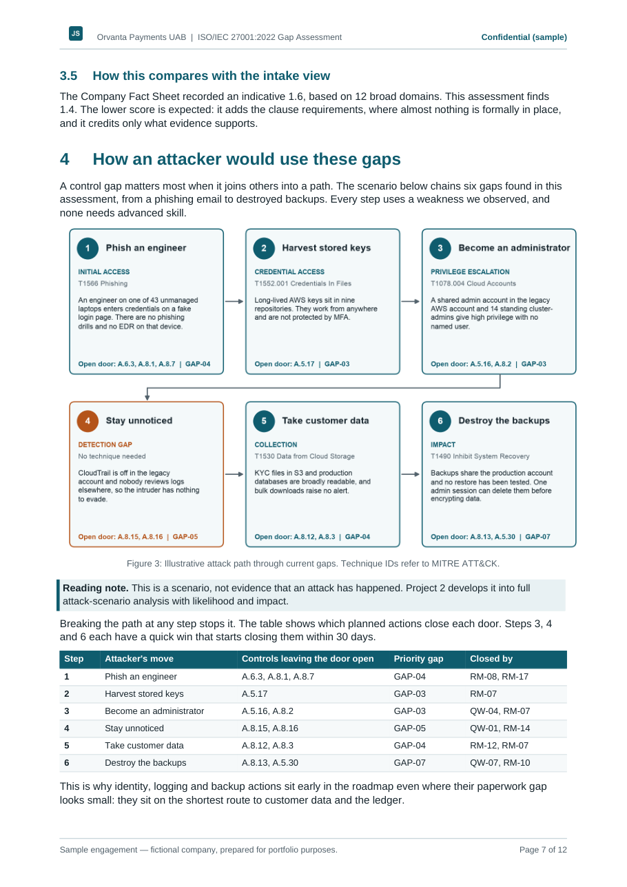

# GRC Portfolio

I am a final-year Information Security student in Baku with GRC and red-team internship experience. This portfolio shows the full range of Governance, Risk and Compliance work through eight connected projects for one fictional client, built to the standard of a professional consulting engagement.

> **Sample engagement — fictional company, prepared for portfolio purposes.** Orvanta Payments UAB does not exist. These are not real clients, audits or certifications. ISO/IEC 27001 Lead Auditor training is in progress.

## What makes it different

- **Threat-informed.** Every gap is tested against one question: would this control prevent or detect a real attack? Gaps are chained into attack paths and mapped to MITRE ATT&CK.
- **One client, one source of truth.** People, systems, vendors, risks and IDs stay consistent across all projects, as they must in a real engagement.
- **Working files, not screenshots.** Excel workbooks recalculate, documents come with source files, and scripts in `tools/` rebuild and validate the deliverables.
- **Written for decision makers.** Each report opens with a one-page summary: situation, findings, business risk and decisions needed.

## The client

[Orvanta Payments UAB](00-company-profile/README.md) is a fictional EU payment institution: 120 people, headquarters in Vilnius, engineering hub in Baku, EUR 3.2 billion in annual payment volume. Enterprise merchants require ISO/IEC 27001:2022 certification by November 2027, and DORA, GDPR and PCI DSS all shape the work.

## Projects

| | Project | What it shows | Status |
|---|---|---|---|
|  | **[0. Company Fact Sheet](00-company-profile/README.md)** | Client baseline: organization, 26 systems, 20 vendors, data flows, regulatory landscape and 12 baseline observations | Complete |
|  | **[1. ISO/IEC 27001:2022 Gap Assessment and Roadmap](01-gap-assessment/README.md)** | 123 requirements scored, attack path analysis, top 10 gaps, quick wins and a 12-month route to certification | Complete |
| | 2. Threat-Informed Risk Assessment | ISO/IEC 27005 method, asset and risk registers, MITRE ATT&CK mapping, attack-scenario deep dives | Planned |
| | 3. ISMS Documentation Suite | Scope, objectives, RACI, 12 policies and 2 procedures | Planned |
| | 4. Statement of Applicability | All 93 controls linked to risks, policies and evidence | Planned |
| | 5. Internal Audit and Management Review | Audit program, findings, root cause analysis, management review pack | Planned |
| | 6. Third-Party Risk Management | Vendor tiering, due diligence questionnaire, DORA register of information | Planned |
| | 7. Business Continuity and Incident Response | BIA, playbooks, notification matrix, tabletop exercise | Planned |
| | 8. Unified Control Framework | Multi-framework control mapping and a Python coverage tool | Planned |

## How the projects connect

A gap found in Project 1 becomes a risk in Project 2, is treated by a control in Project 4, governed by a policy in Project 3 and tested by the audit in Project 5.

## A look inside

| Executive summary | Attack path analysis |
|---|---|
|  |  |

## Repository layout

| Path | Contents |
|---|---|
| `NN-project-name/` | Case study README, `deliverables/` (source files and PDFs), `previews/` and `cover.png` |
| `assets/` | Brand mark and the reusable Word template |
| `tools/` | Python scripts that build and validate the deliverables |

## Frameworks covered so far

ISO/IEC 27001:2022 with Amendment 1:2024, DORA, GDPR, PCI DSS v4.0.1 and NIS2 at scoping level, and MITRE ATT&CK. Standards are referenced by clause number, control ID and short name only; all descriptions are written in my own words.
